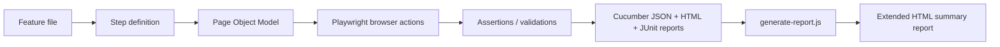
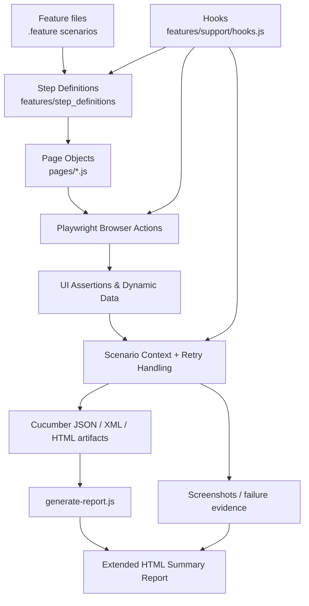

# CLMS Automation Framework - Getting Started

This guide explains the current Playwright + Cucumber JavaScript test automation framework used for the CLMS (Contractor Labour Management System) application. It is designed for new developers, QA engineers, and support teams who need to run, debug, and maintain the solution quickly.

> Note: This project uses `cucumber.js` as the active Cucumber configuration file. The naming convention is profile-based and centralized in one file rather than a separate `cucumber.conf.js`.

---

## 1. Overview & Architecture

### Technology stack

| Layer | Tooling | Role |
| --- | --- | --- |
| BDD runner | Cucumber JS (`@cucumber/cucumber`) | Executes Gherkin scenarios from `features/*.feature` |
| Browser automation | Playwright (`@playwright/test`) | Interacts with the CLMS UI, locators, waits, screenshots, and page context |
| Language | JavaScript / Node.js | Business logic and automation flow |
| Design pattern | Page Object Model (POM) | Encapsulates module-specific UI actions and selectors |
| Reporting | Cucumber HTML, JUnit XML, JSON, Allure | Produces readable execution artifacts for team review and CI |
| Data handling | ExcelJS, dynamic IDs, reusable scenario context | Supports sheet uploads and generated record data |

### Architectural flow



### How the framework is structured

- `features/` contains business-readable scenarios and test data files.
- `features/step_definitions/` maps each Given/When/Then step to JavaScript actions.
- `pages/` contains reusable UI workflows for each CLMS module such as shift, leave, salary, deployment, etc.
- `features/support/hooks.js` manages browser lifecycle, context setup, retry tracking, screenshot capture, and cleanup.
- `cucumber.js` defines test profiles and all output/reporting behavior.
- `playwright.config.js` defines Playwright browser settings, base URL, timeouts, and reporter output.

> Important: in this repo, the actual browser lifecycle is bootstrapped in `features/support/hooks.js`, not strictly by Playwright alone. The hook file resolves the base URL and launches the browser, while `playwright.config.js` provides the default configuration values and reporting setup.

### Execution model

The project follows a layered BDD execution model:

1. Feature files define the scenario intent in plain English.
2. Step definitions bind those steps to concrete action methods.
3. Page objects own selectors and reusable UI logic.
4. Playwright performs the browser actions.
5. Results are captured in JSON/XML/HTML artifacts.
6. `generate-report.js` enriches raw results into a stakeholder-friendly report.

### Current framework architecture diagram



### Feature coverage map

This project is organized by business module. Each feature file validates a real CLMS workflow or validation rule.

| Feature file | Scenario purpose | What it is actually testing |
| --- | --- | --- |
| `login.feature` | User authentication | Verifies login access, session creation, and successful CLMS navigation |
| `contractoremployee.feature` | Contractor employee master verification | Validates master grid visibility, record identity, and contractor employee management flow |
| `contractorEmployeeDetails.feature` | Employee detail screens | Validates detailed employee form fields, data verification, and update validation |
| `contractorEmployeeFormOperations.feature` | Form automation | Fills the employee form, validates mandatory fields, edits entries, and checks data consistency |
| `searchcontractor.feature` | Grid search validation | Searches employee records using identifiers and verifies employee visibility in the grid |
| `gridcountvalidation.feature` | Dynamic counting | Validates active/total counts and expected count changes after record creation or status updates |
| `statuschange.feature` | Status transitions | Changes employee status and validates grid count, transitions, and identity persistence |
| `address.feature` | Address details | Adds and validates address information for contractor employees |
| `bank.feature` | Bank verification | Validates IFSC, bank details, and financial metadata in employee records |
| `uan.feature` | UAN validation | Ensures UAN values are correctly captured and validated |
| `pan_validation.feature` | PAN validation | Tests PAN format and validation behavior in employee details |
| `passport.feature` | Passport validation | Validates passport number input and correctness |
| `pf_number.feature` | PF number validation | Checks PF number field behavior and validation |
| `esic_validation.feature` | ESIC validation | Verifies ESIC number rules and UI handling |
| `otherdetails.feature` | Other details tab | Validates additional employee metadata and reporting-related values |
| `reportingmanager.feature` | Reporting manager flow | Verifies manager assignment, selection, comparison, and update flow |
| `salary.feature` | Salary allocation | Validates earning/deduction calculations, net pay, totals, and salary table logic |
| `shift.feature` | Shift management | Verifies employee shift assignment and shift-related validation |
| `weekoff.feature` | Week-off flow | Checks week-off configuration and employee schedule behavior |
| `workorder.feature` | Work order assignment | Validates assigning and managing work orders to employees |
| `deployment.feature` | Deployment details | Verifies employee deployment information and updates |
| `qualification.feature` | Qualification entry | Validates education details and qualification data entry flow |
| `experience.feature` | Experience entry | Checks experience details, date ranges, and validation logic |
| `family.feature` | Family member management | Adds, verifies, edits, and validates family member information |
| `document.feature` | Document module | Validates document references, file-related actions, and module behavior |
| `card.feature` | Card creation and allocation | Handles new and existing employee card flows and card number validation |
| `fine.feature` | Employee fine module | Tests fine creation, update, and employee penalty workflow |
| `disciplinary_action.feature` | Disciplinary actions | Manages disciplinary action entry, status, and record verification |
| `madical_checkup.feature` | Medical check-up | Validates medical checkup actions and employee history updates |
| `accident.feature` | Accident management | Verifies accident calculations, days count, and report generation |
| `police.feature` | Police verification | Tests police verification actions and result validation |
| `traning.feature` | Training module | Verifies employee training records and module operations |
| `excelUploadContractor.feature` | Bulk upload validation | Uploads contractor Excel sheets, verifies counts, and validates grid search after bulk import |

> The feature names are a strong indicator of the actual business behavior being automated. In this framework, each feature file maps directly to a CLMS module or validation workflow, and the scenario logic is implemented through step definitions plus page objects.

---

## 2. Quick Start Guide

### Prerequisites

Before running the suite, ensure the following are installed:

- Node.js 18+ recommended
- npm or yarn
- A supported browser runtime (Chromium/Chrome is configured by default)
- Access to the CLMS application URL

### Install dependencies

```bash
npm install
```

### Install Playwright browser binaries

```bash
npx playwright install
```

If the environment uses Chrome channel explicitly, make sure Chrome/Chromium is available on the machine.

### Run the default test suite

```bash
npm test
```

This runs the default Cucumber profile and then generates the final report via `generate-report.js`.

### Run a smoke suite

```bash
npm run cucumber:smoke
```

### Run the full BDD suite with the default profile

```bash
npx cucumber-js --profile default
```

### Optional: run with custom environment variables

```bash
BASE_URL="http://192.168.40.115/CLMS_ENT_5.5/app" BROWSER=chromium HEADLESS=true npx cucumber-js --profile smoke
```

---

## 3. Directory Structure Breakdown

```text
CLMS-Automation/
├── features/
│   ├── *.feature                     # Gherkin scenarios grouped by module
│   ├── step_definitions/            # BDD step bindings and assertions
│   │   ├── accident.steps.js
│   │   ├── address.steps.js
│   │   ├── shift.steps.js
│   │   └── ...
│   ├── support/
│   │   └── hooks.js                 # Browser lifecycle, screenshot capture, retry state
│   └── testdata/                    # Feature data or upload-related test assets
├── pages/
│   ├── base.page.js                 # Shared POM base behavior
│   ├── launch.js                    # Browser/navigation setup
│   ├── shift.js                     # Module-level page interactions
│   ├── salary.js
│   ├── deployment.js
│   ├── reportingmanager.js
│   ├── mastermodule/
│   └── otherdetailspage/
├── utilities/
│   ├── basePage.js
│   ├── browserManager.js
│   ├── testConfig.js
│   ├── testConfig.json
│   ├── testData.json
│   └── testUtils.js
├── screenshots/                     # Failure screenshots captured by hooks
├── reports/                         # Generated or supporting reports
├── test-results/                    # Playwright and JUnit output
├── playwright-report/               # Playwright HTML report folder
├── allure-results/                  # Allure raw result files
├── cucumber.js                      # Cucumber profiles and formatters
├── playwright.config.js             # Browser defaults and timeout configuration
├── generate-report.js               # Custom summary/report assembly logic
├── package.json                     # npm scripts
├── server.js                        # Optional local app/server entry
├── Jenkinsfile                      # CI pipeline definition
├── cucumber-report.html            # Standard generated HTML report
├── cucumber-report.json            # Raw Cucumber execution JSON
├── cucumber-results.xml             # JUnit report
├── count-report.html                # Additional summary artifact
└── GETTING_STARTED.md              # This guide
```

### Key sections explained

#### `features/`
This is the BDD layer. Each feature file defines user journeys in Gherkin and is grouped by business area like shift, deployment, salary, qualification, and other CLMS modules.

#### `features/step_definitions/`
Each JavaScript step file binds human-readable scenario language to actual browser actions. These files are often organized by module and contain navigation, field entry, validation, and business result checks.

#### `features/support/hooks.js`
This is the runtime backbone of the framework. It creates browser and page contexts before each scenario, sets global timeouts, tracks scenario retries, captures screenshots on failure, and closes browser resources after execution.

#### `pages/`
Page Object Model classes centralize selectors and UI interaction methods such as:

- opening modules
- filling form values
- clicking action buttons
- reading table values
- validating popups and status messages

This reduces test duplication and makes updates easier when the application UI changes.

#### `reports/` and generated artifacts
The project writes raw and derived artifacts such as:

- `cucumber-report.json`
- `cucumber-results.xml`
- `cucumber-report.html`
- `playwright-report/`
- `screenshots/`
- `allure-results/`

These artifacts support debugging and stakeholder review.

---

## 4. Execution Commands

### Core npm scripts

| Command | Purpose |
| --- | --- |
| `npm test` | Default suite run + final report generation |
| `npm run cucumber` | Runs default Cucumber profile |
| `npm run cucumber:smoke` | Runs only `@SMOKE` tagged scenarios |
| `npm run cucumber:regression` | Runs `@REGRESSION` or `@MODULE` scenarios |
| `npm run cucumber:shift` | Runs shift module scenarios |
| `npm run cucumber:leave` | Runs leave module scenarios |
| `npm run cucumber:attendance` | Runs attendance scenarios |
| `npm run cucumber:report` | Regenerates reports from current JSON artifacts |
| `npm run allure:report` | Builds the Allure report |
| `npm run clean` | Removes generated screenshots, HTML, JSON, and videos |

### Default test execution

```bash
npm test
```

This command is configured in `package.json` and runs:

```bash
cucumber-js --profile default ; node generate-report.js
```

### Specific profile execution

```bash
npx cucumber-js --profile smoke
npx cucumber-js --profile regression
npx cucumber-js --profile shift
npx cucumber-js --profile leave
npx cucumber-js --profile attendance
```

### Tag-based execution

You can also run targeted scenarios using Cucumber tag filters:

```bash
npx cucumber-js --tags "@SMOKE"
npx cucumber-js --tags "@REGRESSION"
npx cucumber-js --tags "@SHIFT"
```

### Retry strategy

The default Cucumber profile includes automatic retries:

```js
retry: 2
```

This means failed scenarios can be retried automatically to reduce intermittent failures. The framework also tracks retry counts in `features/support/hooks.js` and logs scenario retry attempts during execution.

You can override retry count on the command line:

```bash
npx cucumber-js --profile default --retry 3
```

---

## 5. Advanced Features & Reporting

### Browser lifecycle and retry handling

The support hooks file contains the runtime control layer responsible for:

- creating a new browser instance once per suite
- creating a fresh context and page for each scenario
- setting a default timeout of 30 seconds
- logging scenario start and retry attempts
- taking a screenshot on failed scenarios
- cleaning up pages and browser objects after each test

This makes the framework resilient to flaky UI timing issues and helps preserve a clean test environment.

### Retry and execution metadata

`features/support/hooks.js` tracks scenario retries using a map keyed by scenario ID and prints messages similar to:

```bash
🔄 Retrying Scenario (Attempt 2): "Update salary status"
```

This is particularly useful when the CLMS application intermittently delays DOM updates, validation popups, or form saves.

### Report generation quality

The project uses both Cucumber output and a custom report assembly process:

- `cucumber.js` creates JSON, HTML, and JUnit reports.
- `playwright.config.js` also generates Playwright HTML and JUnit artifacts.
- `features/support/hooks.js` handles scenario-level evidence capture during the `After` hook.
- `generate-report.js` reads the JSON results and turns them into richer summary tables and visual category breakdowns.

This is the key pattern in the framework: the `After` hook captures failure evidence and attachments, while the report builder converts the raw JSON into a more polished, business-friendly HTML summary with totals, feature breakdowns, and scenario rows.

### Screenshot and evidence capture

During the `After` hook, a failed scenario automatically:

- creates a screenshot under `./screenshots/`
- names the file using the sanitized scenario title
- attaches the screenshot to the Cucumber report output if supported

This is especially useful when debugging CLMS forms, tables, popup validations, and complex status-based workflows.

### Optional Allure integration

This repository includes Allure-related scripts:

```bash
npm run allure:report
npm run allure:clean
```

Allure is useful when richer lifecycle reporting or test analytics are required beyond the built-in Cucumber HTML output.

---

## 6. Troubleshooting Guide

### 1) Flaky tests and intermittent failures

Flaky behavior is common in enterprise UI automation when there are delayed JS updates, async validations, or popups.

Recommended actions:

- Re-run with a retry profile:

```bash
npx cucumber-js --profile default --retry 3
```

- Review screenshots in `screenshots/` for the exact failing UI state.
- Inspect the Cucumber JSON and HTML report for the actual failing step.
- Prefer stable selectors and explicit waits over hard-coded sleeps.

### 2) DOM synchronization issues

CLMS forms often depend on input events like `input`, `change`, and `blur` to trigger validation or dependent field updates. Some elements may not behave correctly if a value is set without firing the expected events.

Common fixes:

```javascript
await locator.fill('123456');
await locator.press('Tab');
await expect(locator).toHaveValue('123456');
```

If the page requires custom event validation, use a stronger event-driven approach:

```javascript
await locator.fill('abc');
await locator.dispatchEvent('input');
await locator.dispatchEvent('change');
```

For dropdowns or searchable selects, ensure the value is selected and then the UI finishes its re-render before the next step.

### 3) Timeout tuning

The project sets timeouts in two places:

- `cucumber.js` uses `timeout: 60000`
- `features/support/hooks.js` sets `setDefaultTimeout(30000)`
- `playwright.config.js` sets `timeout: 30 * 1000` and `navigationTimeout: 30000`

If your application is slower in a lower-environment deployment, you can increase the timeout:

```js
// in cucumber.js
timeout: 90000
```

or override environment-specific values in the execution command.

### 4) Browser and environment issues

Set the correct URL and browser explicitly if the app is not starting correctly:

```bash
BASE_URL="http://192.168.40.115/CLMS_ENT_5.5/app" BROWSER=chromium HEADLESS=true npx cucumber-js --profile smoke
```

If Chrome-based execution fails, use `chromium` or install the appropriate browser binary.

### 5) Report not generated or incomplete

If reports do not appear, try:

```bash
npm run cucumber:report
```

Then check:

- `cucumber-report.json`
- `cucumber-report.html`
- `playwright-report/`
- `test-results/`

### 6) Debugging a single failing scenario

Use a targeted scenario run with a tag or feature path:

```bash
npx cucumber-js features/some-module.feature --profile default
```

or:

```bash
npx cucumber-js --tags "@SMOKE" --profile smoke
```

This narrows the run to the failing logic and helps isolate browser-state issues quickly.

---

## Best Practices for New Team Members

1. Start with the default smoke profile to confirm the app is healthy.
2. Read feature files before editing step definitions.
3. Keep page objects focused on a single module or workflow.
4. Reuse scenario data and avoid hardcoding fragile values when generated IDs are available.
5. Always capture evidence on failure through screenshots and report artifacts.
6. Prefer explicit waits and stable selectors over fixed delays.

---

## Recommended first commands

```bash
npm install
npx playwright install
npm test
```

From there, move to targeted profiles such as:

```bash
npm run cucumber:smoke
npm run cucumber:regression
npm run cucumber:shift
```

This is the fastest way to understand the framework, confirm the CLMS app is reachable, and begin adding or fixing automated coverage.

---

## Summary

This framework combines the strengths of BDD, Playwright automation, and reusable page objects into a practical test suite for CLMS processes. It is designed to be scalable, maintainable, and easy to diagnose when failures happen in enterprise workflows.

For day-to-day execution, focus on the following:

- `cucumber.js` for profiles and reporting settings
- `playwright.config.js` for browser and timeout controls
- `features/support/hooks.js` for browser lifecycle and failure capture
- `pages/` for module-specific UI actions
- `generate-report.js` for final summary reporting

If you follow this structure consistently, you will have a clean path to building stable automation for the CLMS application.


TestUtils.sleep(1000);
TestUtils.generateRandomString(10);
TestUtils.getRandomNumber(1, 100);
TestUtils.formatDate(new Date());
TestUtils.parseCurrency('₹ 500');  // Returns 500
TestUtils.retryWithBackoff(asyncFn, 3, 1000);
```

### Base Page Utilities
```javascript
const BasePage = require('./utilities/basePage');

class MyPage extends BasePage {
  constructor(page) {
    super(page);
  }

  async myMethod() {
    await this.navigate('https://example.com');
    await this.click('#button');
    const text = await this.getText('#element');
    await this.scrollToElement('#target');
  }
}
```

## Continuous Integration

### GitHub Actions Example
```yaml
name: Playwright Tests
on: [push, pull_request]

jobs:
  test:
    runs-on: ubuntu-latest
    steps:
      - uses: actions/checkout@v2
      - uses: actions/setup-node@v2
        with:
          node-version: '16'
      - run: npm install
      - run: npx playwright install
      - run: npm test
      - uses: actions/upload-artifact@v2
        if: failure()
        with:
          name: playwright-report
          path: playwright-report/
```

## File Descriptions

| File | Purpose |
|------|---------|
| `cinepolisHomePage.js` | Movie selection page interactions |
| `cinepolisLocationPage.js` | Location and theater selection |
| `cinepolisShowtimePage.js` | Showtime display and selection |
| `cinepolis​SeatSelectionPage.js` | Seat layout and selection |
| `cinepolisBookingSummaryPage.js` | Booking summary and confirmation |
| `apiInterceptor.js` | API mocking and request tracking |
| `testUtils.js` | Common utility functions |
| `basePage.js` | Base page methods for all pages |
| `fixtures.js` | Test fixtures and setup |
| `playwright.config.js` | Playwright configuration |

## Support and Maintenance

**Version**: 1.0.0
**Last Updated**: 2026-04-29
**Playwright Version**: Latest
**Node Version**: 14+

## Next Steps

1. **Install dependencies**: `npm install`
2. **Run tests**: `npm test`
3. **View report**: `npm run test:report`
4. **Explore fixtures**: Check `fixtures/fixtures.js`
5. **Update selectors**: If UI changes, update page objects
6. **Add new tests**: Create new test files following existing patterns

## Tips

- Use `--headed` flag to see tests running
- Use `--debug` flag for step-by-step debugging
- Check HTML report for detailed results and screenshots
- Use page object methods instead of raw selectors
- Keep test data in fixtures for easy maintenance
- Use API mocking for testing error scenarios

---

For more information, see [README.md](README.md)
