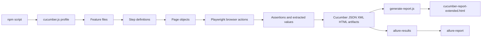

# CLMS Automation Quick Reference

This document is a code-aligned quick reference for the current CLMS Playwright + Node.js + Cucumber automation framework. It focuses on how the framework is actually wired today: feature execution, step-definition orchestration, page-object ownership, dynamic test-data generation, Excel upload parsing, and extended report enrichment.

## 1. Framework and Existing File Workflow Architecture

### 1.1 Technology Stack

| Layer | Technology | Purpose |
| :--- | :--- | :--- |
| Test runner | Cucumber (`@cucumber/cucumber`) | BDD scenario execution through Gherkin feature files |
| Browser automation | Playwright (`@playwright/test`) | UI automation, assertions, locators, browser/session control |
| Language/runtime | Node.js / JavaScript | Execution runtime for steps, pages, utilities, and report scripts |
| Reporting | Cucumber HTML Reporter, JUnit XML, Allure | Human-readable report output plus CI-friendly artifacts |
| Data extraction | ExcelJS | Reads uploaded Excel sheets for post-upload verification |
| CI integration | Jenkinsfile | Pipeline-driven execution and report publishing |

### 1.2 Current File Workflow Architecture

The framework follows a layered execution model where business-readable scenarios are translated into reusable code modules instead of embedding UI actions directly inside tests.

| Layer | Primary Files | Responsibility |
| :--- | :--- | :--- |
| Business scenarios | `features/*.feature` | Defines test intent in Gherkin and supplies example data |
| Action binding | `features/step_definitions/*.js` | Maps scenario steps to executable actions and assertions |
| UI abstraction | `pages/**/*.js` | Owns locators, workflows, parsing logic, and module-specific UI behavior |
| Shared support/config | `features/support/*`, `cucumber.js`, `utilities/*` | Runtime setup, profiles, helpers, and environment settings |
| Artifact generation | `cucumber-report.json`, `cucumber-results.xml`, `allure-results/` | Raw execution evidence |
| Final report assembly | `generate-report.js` | Produces `cucumber-report-extended.html` and optional Allure output |

### 1.3 End-to-End Execution Flow



### 1.4 Step-by-Step Comparison: Legacy/Existing Baseline vs Current Framework

The table below uses a legacy baseline model common in older UI suites: direct script execution, limited reuse, and mostly manual result interpretation. The right-hand side reflects the framework currently implemented in this repository.

| Step | Legacy / Existing Baseline Workflow | Current Framework Workflow |
| :--- | :--- | :--- |
| 1. Start execution | Run a single script or a small set of procedural test files | Run named npm scripts such as `cucumber:all`, `cucumber:smoke`, `cucumber:regression`, or module-specific profiles |
| 2. Test definition | Test logic mixed with UI actions | Feature files describe behavior, while step definitions translate intent into code |
| 3. Module routing | Test file decides everything inline | `cucumber.js` profile decides tags, output formats, timeouts, and execution scope |
| 4. UI handling | Locators repeated across tests | Page Object Model centralizes locators and UI actions per business module |
| 5. Test data handling | Hardcoded values or manual edits in scripts | Dynamic Aadhaar, card, UAN, and bank-account generation; scenario examples and reusable context storage |
| 6. Sheet processing | Upload file and visually inspect result | Upload each sheet, parse Excel with ExcelJS, extract search keys, and verify grid retrieval programmatically |
| 7. Validation | Human checks popups/tables manually | Assertions normalize popup text, inspect counts, validate tables, and compare derived calculations |
| 8. Reporting | Basic HTML/pass-fail output | JSON + HTML + JUnit + optional Allure, enriched with markdown tables, JSON attachments, and HTML comparison charts |
| 9. Failure analysis | Re-run and inspect UI manually | Reports carry scenario detail, computed evidence, popup text, comparison tables, and CI artifacts |
| 10. Maintenance cost | High due to duplicated selectors and flow code | Lower due to isolated page classes, reusable steps, and profile-driven execution |

### 1.5 Workflow Detail: Current Framework

1. A package script starts Cucumber with a specific profile from `cucumber.js`.
2. The selected profile loads feature files, step definitions, support hooks, and output formatters.
3. Each Gherkin step maps to a step-definition method.
4. Step definitions instantiate or reuse page objects for the relevant module.
5. Page objects interact with the CLMS UI using Playwright locators and assertions.
6. Dynamic values such as Aadhaar, card number, UAN, or generated account number are stored in scenario context (`this.*`) for downstream reuse.
7. Scenario outputs are written into raw artifacts such as `cucumber-report.json`, `cucumber-results.xml`, screenshots, and optionally Allure results.
8. `generate-report.js` transforms the Cucumber JSON into `cucumber-report-extended.html` and module-specific HTML reports.
9. Jenkins publishes the extended HTML report and archives Playwright/Test artifacts.

### 1.6 Architecture Benefits and Efficiency Gains

| Area | Previous Pain Point | Current Improvement | Practical Benefit |
| :--- | :--- | :--- | :--- |
| Reusability | Repeated UI locators in many tests | Locators and workflows are owned by page objects | Faster locator maintenance after UI changes |
| Selective execution | Hard to isolate module runs | Profiles for default, shift, leave, attendance, smoke, regression, API, negative, accessibility | Faster debugging and targeted CI jobs |
| Test data | Static values cause collisions | Timestamp/randomized identifiers reduce reuse conflicts | Lower duplicate-data failures |
| Bulk upload verification | Manual upload plus visual search | Automated Excel parsing and grid search validation | Full upload audit trail per file |
| Reporting detail | Limited pass/fail visibility | Attached markdown, plain text, HTML, and JSON evidence | Faster root-cause analysis |
| CI output | Only console logs | HTML/JUnit/Allure-ready outputs | Better traceability in Jenkins and external dashboards |

## 2. Data Extraction and Sheet Operations

### 2.1 Primary Upload Automation Module

Bulk sheet operations are implemented in `pages/mastermodule/excelUploadContractor.js` and are triggered from `features/step_definitions/excelUploadContractor.steps.js`.

Core responsibilities of the upload page object:

- Detect the Excel Upload icon on the Contractor Employee grid.
- Open and validate the upload popup.
- Confirm the initial no-file-selected state.
- Upload one or many `.xlsx` files sequentially.
- Read success and failed counts from the popup.
- Extract searchable identifiers from popup rows or directly from Excel files.
- Validate that uploaded records are retrievable from the CLMS grid by code, Aadhaar/card number, and combined filters.

### 2.2 Sheet Upload Process

1. The scenario opens the Contractor Employee screen and clicks the Excel Upload icon.
2. The upload popup is validated for title and close-button availability.
3. The framework resolves the target folder path with `path.resolve(process.cwd(), relativeFolderPath)`.
4. It reads the folder contents with `fs.readdirSync(...)`.
5. Only `.xlsx` files are processed, while temporary Office lock files beginning with `~$` are skipped.
6. For each file, the framework ensures the popup is open, resets the file input, sets the selected file, and clicks the upload button.
7. After upload, the framework reads success and failure counters from the popup and branches into result validation.

### 2.3 Data Extraction Mechanics

The framework does not depend only on UI output. It also reads the source sheet directly so validation remains possible even when the upload popup renders incomplete or delayed data.

| Extraction Target | Mechanism | Logic |
| :--- | :--- | :--- |
| Uploaded file list | `fs.readdirSync` | Enumerates candidate Excel files in the target folder |
| Workbook loading | `ExcelJS.Workbook().xlsx.readFile(filePath)` | Reads the uploaded Excel workbook directly from disk |
| Worksheet selection | `workbook.worksheets[0]` | Uses the first sheet as the data source |
| Aadhaar/card column detection | Header scan of row 1 | Dynamically finds `AadharCardNo` or `CardNumber` column instead of hardcoding the index |
| Aadhaar/card value extraction | Cell cleanup | Converts object/text/formula values to string and strips non-digits with `/[^0-9]/g` |
| Primary search code | First data row lookup | Reads row 2 cell 1, falling back to row 2 cell 2 |
| UI popup row extraction | DOM table parsing | Collects code from the first cell and scans later cells for a numeric identifier |

### 2.4 Upload Validation Logic

Once upload is complete, `verifyDynamicStatus(fileName, filePath)` performs a multi-stage validation:

1. Waits for the failed-count element to become visible.
2. Reads `successCount` and `failedCount` from the popup.
3. If failures exist, it verifies that the failed-status table exposes `FAILED` in the status cell when the row is visible.
4. If successful rows exist, it inspects the passed-record grid and collects up to three records for downstream validation.
5. If popup parsing yields no usable record data, it falls back to Excel-based extraction.
6. It closes the popup and validates the extracted records against the main grid using three search strategies.

### 2.5 Search Verification After Upload

| Search Type | Input Source | Validation Rule |
| :--- | :--- | :--- |
| Code-only search | Popup table or Excel row | Searches the code column and expects a matching grid row or logs no-record evidence |
| Aadhaar/card-only search | Popup table digits or Excel column | Searches the Aadhaar/card field and verifies record presence |
| Combined search | Code + Aadhaar/card | Applies both filters together and confirms the row still resolves correctly |

### 2.6 Fallback and Resilience Strategy

| Situation | Fallback Used | Why It Matters |
| :--- | :--- | :--- |
| Upload popup table is slow to render | Additional wait and visibility checks | Reduces false negatives caused by delayed UI refresh |
| Popup has incomplete data | ExcelJS file parsing | Keeps verification source-of-truth aligned with uploaded data |
| Aadhaar/card value includes formatting characters | Non-digit cleanup | Ensures grid search uses a normalized numeric value |
| Popup is closed between iterations | Re-open popup when needed | Supports batch upload loops without manual reset |

### 2.7 Header Count Verification for Uploads

The `pages/countvalidatio.js` module exposes live `Active` and `Total` header counts. In the bulk-upload count scenario, the framework captures counts before upload and verifies that counts increase by the number of successfully uploaded records.

This makes the upload validation two-dimensional:

- Transaction-level validation: the popup reports success/failure counts.
- System-level validation: the grid header counts reflect the net inserted records.

## 3. Core Generation and Validation Logics

### 3.1 Unique Aadhaar Generation Logic

The primary runtime-generated Aadhaar value used in contractor-employee creation flows is produced in `contractorEmployeeDetails.steps.js`:

```js
const dynamicId = '7' + Date.now().toString().slice(-11);
```

#### How the algorithm works

| Stage | Logic | Result |
| :--- | :--- | :--- |
| Prefix selection | Fixed prefix `'7'` | Ensures a 12-digit identifier begins with a non-zero digit |
| Uniqueness source | `Date.now()` | Uses current epoch milliseconds for high uniqueness across runs |
| Length normalization | `.slice(-11)` | Keeps the trailing 11 digits from the timestamp |
| Final assembly | `'7' + <11 digits>` | Produces a 12-digit test identifier |

#### Context propagation

The generated value is stored in multiple scenario-context keys:

- `this.createdAadhaar`
- `this.generatedAadhaar`
- `this.aadhaarNumber`
- `this.identityNumber`
- `this.createdAadhar`

This allows downstream steps to reuse the same identity in card allocation, grid search, status-change validation, and other record-specific flows without re-querying the UI.

#### Additional Aadhaar helper

`pages/countvalidatio.js` also contains a generic helper:

```js
Math.floor(100000000000 + Math.random() * 900000000000).toString()
```

This creates a random 12-digit number and is useful as a general-purpose dynamic identity generator for count-related scenarios.

#### Important validation note

The framework currently optimizes Aadhaar generation for uniqueness and execution safety. It does not implement a Verhoeff checksum or government-format verification algorithm in test code. Validation is therefore functional for CLMS automation, not a formal Aadhaar authenticity engine.

### 3.2 Card Number Generation Based on Aadhaar

Temporary card allocation builds a card number from the generated Aadhaar:

```js
const randomNum = Math.floor(100 + Math.random() * 900);
const dynamicCardNum = 'C' + cleanId + randomNum;
```

#### Behavior summary

- Prefix: `C`
- Core body: the cleaned Aadhaar/identity number stored in context
- Entropy: a 3-digit random suffix between `100` and `999`
- Typical output pattern when based on generated Aadhaar: `^C\d{15}$`

This keeps the card number human-traceable back to the employee identity used in the scenario while still reducing collision risk.

### 3.3 Bank, IFSC, and Account Number Logic

#### Observed bank workflow

The bank-details automation performs four coordinated actions:

1. Select bank option from the dropdown.
2. Enter IFSC code.
3. Enter branch name.
4. Enter bank account number and submit.

Each field is actively cleared and re-entered before dispatching `input` and `change` events. This is important because CLMS field validation appears to be event-driven.

#### Unique bank account generation

When the feature data passes `UNIQUE` or a short placeholder value, the framework generates a deterministic unique account number:

```js
const uniqueDigits = Date.now().toString().slice(-6);
finalAccountNo = `1515${uniqueDigits}000`;
```

| Component | Meaning |
| :--- | :--- |
| `1515` | Stable test prefix |
| `Date.now().slice(-6)` | Runtime uniqueness component |
| `000` | Fixed suffix |

Observed generated-pattern regex:

```regex
^1515\d{6}000$
```

#### IFSC validation contract

The automation itself does not regex-validate IFSC before entry; it relies on CLMS application validation and then asserts the popup message. Based on the accepted/rejected examples in `bank.feature`, the expected business pattern is:

```regex
^[A-Z]{4}0[A-Z0-9]{6}$
```

Examples from the suite:

| Example | Outcome | Reason |
| :--- | :--- | :--- |
| `HDFC0001277` | Valid | 4 letters + `0` + 6 alphanumeric digits |
| `SBIN0001247` | Valid | Standard IFSC-like structure |
| `12345678901` | Invalid | Missing bank alpha prefix structure |
| `SBIN12345` | Invalid | Too short for observed IFSC contract |

#### Bank account validation strategy

Bank-account validation is also server/UI-driven. The framework verifies final behavior by comparing normalized popup text against the expected scenario message, such as:

- `Updated Successfully`
- `Bank account no already exists`
- `Please select bank,if you have given bank details`

### 3.4 PF Number Logic

The PF validation flow is intentionally simple in test code:

1. Wait for the PF input field.
2. Clear the existing value.
3. Fill the supplied PF number if present.
4. Click update/save.
5. Read the SweetAlert popup text.
6. Normalize whitespace and assert that the popup contains the expected message.

#### Observed PF formats in the suite

Two business formats appear across the current test assets:

| Context | Example | Observed Shape |
| :--- | :--- | :--- |
| Other Details validation | `MHBAN01911100012505099` | Compact uppercase alpha-numeric format |
| Contractor employee create/edit form | `MH/PUN/0012345/000/0000101` | Slash-delimited regional format |

Observed regexes aligned to current scenarios:

```regex
Compact PF format: ^[A-Z]{5}\d{17}$
Slash-delimited PF format: ^[A-Z]{2}\/[A-Z]{3}\/\d{7}\/\d{3}\/\d{7}$
```

Combined documentation regex for both currently observed styles:

```regex
^(?:[A-Z]{5}\d{17}|[A-Z]{2}\/[A-Z]{3}\/\d{7}\/\d{3}\/\d{7})$
```

#### PF validation behavior in practice

| Input Example | Expected System Response |
| :--- | :--- |
| `MHBAN01911100012505099` | `Updated Successfully` |
| blank value | `Updated Successfully` |
| `MHBAN090906455099` | `PF Number: "..." Is InValid.` |
| `mHBAN09090640005555099` | Invalid because mixed/lower-case format is rejected |
| `MHBAN00000640005555000` | `PF no already exists` |

### 3.5 UAN Logic

Although not requested as a primary subsection, UAN participates in the same Other Details validation model and is often referenced with PF.

When the scenario value is `UNIQUE`, the framework generates:

```js
finalUan = `10150${randomSuffix}`;
```

This produces a 12-digit UAN-style number with a stable prefix and randomized suffix. Validation remains popup-driven after update/save.

### 3.6 Validation Design Pattern Used Across Modules

The framework uses a consistent validation pattern for bank, PF, UAN, ESIC, salary, and several update flows.

| Phase | Typical Implementation |
| :--- | :--- |
| Input | Wait for control, clear existing data, fill new value |
| Trigger | Click update/save action |
| Capture | Wait for SweetAlert or page table refresh |
| Normalize | Trim or compress whitespace when comparing messages |
| Assert | Check expected substring, numeric equality, or row presence |
| Record | Log detailed execution info and attach structured evidence where applicable |

## 4. Extended Reporting and Data Verification

### 4.1 Report Artifact Pipeline

The framework generates multiple output layers during execution.

| Artifact | Produced By | Purpose |
| :--- | :--- | :--- |
| `cucumber-report.json` | Cucumber formatter | Primary structured execution result used by the extended HTML report |
| `cucumber-report.html` | Cucumber formatter | Standard HTML output |
| `cucumber-results.xml` | Cucumber formatter | CI/JUnit-compatible result feed |
| `allure-results/` | Runtime execution | Allure raw result storage |
| `cucumber-report-extended.html` | `generate-report.js` | Main enriched HTML report for stakeholders |
| `cucumber-report-{module}-extended.html` | `generate-report.js` | Module-specific extended reports |
| `allure-report/` | Allure CLI | Secondary report visualization layer |

### 4.2 What `generate-report.js` Adds

`generate-report.js` transforms raw Cucumber JSON into business-consumable HTML and adds execution metadata such as:

- App version
- Environment
- Browser
- Platform
- Execution mode
- Scenario timestamping

It also:

- Creates the main extended report.
- Creates module-specific reports for shift, leave, and attendance when JSON files exist.
- Attempts Allure report generation.
- Opens the main HTML report automatically when possible.

### 4.3 Report Enrichment Through Attachments

Extended reporting in this framework is not limited to pass/fail status. Step definitions enrich reports with scenario-specific attachments using `this.attach(...)`.

| Attachment Type | MIME Type | Example Use |
| :--- | :--- | :--- |
| Plain text | `text/plain` | Calculation logs, popup results, tabular summaries |
| Markdown | `text/markdown` | Salary comparison tables and structured verification charts |
| HTML | `text/html` | Rich comparison chart for reporting-manager update validation |
| JSON | `application/json` | Raw extracted/compared data snapshots |

### 4.4 Data Mapping in the Extended Report

The data-mapping pattern is:

1. Read raw UI values from locators or the DOM.
2. Normalize or parse values into comparable numeric/text structures.
3. Build a structured comparison table in plain text, markdown, HTML, or JSON.
4. Attach the formatted payload to the running Cucumber scenario.
5. Let the Cucumber JSON serializer persist that attachment.
6. Render the attachment content inside the extended HTML report.

### 4.5 Salary Module as the Best Reporting Example

The salary module demonstrates the reporting pattern most clearly.

#### Reported calculations include:

- Raw total earning text from the UI
- Parsed total earning value
- Raw total deduction text from the UI
- Parsed total deduction value
- Calculated projected net payable
- UI-displayed projected net payable
- Final PASS/FAIL status based on numeric equality

#### Salary report table shape

| Field | Source | Transformation | Final Assertion |
| :--- | :--- | :--- | :--- |
| Total Earning | UI span text | Remove commas, parse float | Used in net-payable formula |
| Total Deduction | UI span text | Remove commas, parse float | Used in net-payable formula |
| Projected Net Payable | UI label/body text | Regex number extraction, parse float | Compared to `earning - deduction` |
| Status | Computed | Absolute difference threshold `< 0.1` | PASS or FAIL |

### 4.6 Report Readability Features

The current extended report design supports:

- Scenario timestamps
- Module-specific report separation
- Inline calculation evidence
- Popup-message evidence
- Table-based business comparison views
- CI publishing through Jenkins HTML publishing and artifact archiving

## 5. UI vs Logic Comparison Matrix

The matrix below maps visible CLMS UI controls to the framework logic behind them and to the assertion/result model used by automation.

| UI Input Field / Element | Framework Logic / Backend Handling | Expected Output | Actual Framework Validation Result |
| :--- | :--- | :--- | :--- |
| Aadhaar Card No textbox | Generates `7 + last 11 digits of Date.now()` and stores value in scenario context for reuse | A unique 12-digit identifier is entered successfully | Framework verifies visibility, fills the field, and reuses the same value in later steps such as card allocation and search |
| Contractor Employee grid search for Aadhaar/employee details | Uses shared search step and grid search locators with visible-input fallback | Matching employee row should be retrievable | Framework enters search text, submits search, and waits for matching grid evidence |
| Allocate Temporary Card button | Opens card allocation flow from employee profile | Card allocation controls become available | Framework asserts button visibility before interaction |
| Card Number input | Builds card number as `C + Aadhaar + 3 random digits` | Unique card number should save and appear in the card table | Framework stores generated card number and later asserts that the saved table contains that value |
| Effective From / Effective To fields | Direct value injection plus event dispatch for date handling | Valid date range saves; invalid range shows popup | Framework sets dates programmatically and validates popup text for incorrect date order |
| Excel Upload icon and popup | Locates popup trigger, validates title and buttons, resets file input between uploads | Upload dialog should open and accept Excel sheets | Framework asserts icon visibility, popup title, close buttons, and initial empty file-input state |
| Excel file input | Sequentially uploads all `.xlsx` files from target folder | Files should upload and produce success/failure counts | Framework reads success/failure counters and correlates records back to the main grid |
| Uploaded popup passed/failed rows | Parses popup table data, extracts code and Aadhaar/card digits, or falls back to ExcelJS parsing | Uploaded records should be verifiable post-upload | Framework validates failed rows when present and searches main grid using extracted identifiers |
| Bank dropdown | Selects option by label | Bank should be accepted when valid data exists | Framework records selected bank and validates resulting popup message after save |
| IFSC Code field | Clears field, fills value, dispatches events, relies on CLMS validation | Valid IFSC should save; invalid format should raise error | Framework compares SweetAlert text against expected message such as `Invalid` or `Updated Successfully` |
| Bank Account Number field | Uses input value directly or generates `1515 + last 6 timestamp digits + 000` for unique cases | Unique account should save; duplicates/select omissions should be rejected | Framework normalizes popup text and asserts containment of expected bank-validation message |
| PF Number field | Clears and fills the PF value exactly as supplied by scenario examples | Valid PF saves; invalid or duplicate PF returns business message | Framework reads popup text and asserts normalized expected substring |
| UAN Number field | Generates a unique 12-digit UAN when scenario uses `UNIQUE` | Valid UAN saves or duplicate/length errors appear | Framework stores tested UAN and validates popup text after update |
| Header Active/Total counts | Captures counts before create/upload operations | Counts should increase by inserted record volume | Framework compares before/after header values against expected increments |
| Salary structure totals and projected net payable | Parses UI values, performs arithmetic, builds markdown tables | UI calculations must equal derived automation calculation | Framework attaches markdown summary and throws explicit mismatch errors when values diverge |
| Reporting Manager comparison view | Builds HTML chart showing old vs updated values | Updated manager should match intended selection/search result | Framework attaches an HTML comparison chart with PASSED or FAILED state |

## 6. Recommended Usage Notes for QA and Developers

### 6.1 When debugging failures

- Check `cucumber-report.json` first if an extended HTML report looks incomplete.
- Review popup-message assertions for bank, PF, UAN, and date validations because these flows are message-driven.
- For bulk upload failures, inspect both the popup counts and the Excel source file because the framework intentionally cross-validates both.
- For report discrepancies, verify whether the data was attached as plain text, markdown, HTML, or JSON in the originating step definition.

### 6.2 When adding a new validation module

Follow the current framework pattern:

1. Add the business scenario in a feature file.
2. Create or extend the step-definition file.
3. Keep locators and business UI actions in a page object.
4. Store dynamic values in scenario context when later steps need them.
5. Normalize popup or table output before comparing.
6. Attach structured evidence when the scenario benefits from a richer report.

### 6.3 Key operational commands

| Command | Purpose |
| :--- | :--- |
| `npm run cucumber:all` | Run full framework flow and generate reports |
| `npm run cucumber:smoke` | Run smoke-tagged scenarios |
| `npm run cucumber:regression` | Run regression-tagged scenarios |
| `npm run cucumber:shift` | Run shift profile |
| `npm run cucumber:leave` | Run leave profile |
| `npm run cucumber:attendance` | Run attendance profile |
| `npm run cucumber:report` | Generate HTML/Allure reports from available artifacts |
| `npm run allure:clean` | Remove Allure artifacts |
| `npm run clean` | Remove generated screenshots, videos, reports, JSON, and HTML outputs |

## 7. Summary

This framework moves CLMS automation away from a flat execute-and-observe model into a layered, report-rich, data-aware system. Its strongest characteristics are:

- Clear separation between business scenarios, execution code, and UI abstractions.
- Reliable dynamic test-data generation for collision-prone identity fields.
- Excel upload verification that validates both the upload transaction and the final grid state.
- Extended reporting that captures not only pass/fail, but also the actual business evidence used in assertions.

For day-to-day work, the most important implementation hotspots are:

- `cucumber.js` for execution profiles
- `generate-report.js` for report assembly
- `features/step_definitions/*` for business-step orchestration
- `pages/mastermodule/excelUploadContractor.js` for sheet upload and extraction
- `pages/card.js`, `pages/otherdetailspage/bank.js`, `pages/otherdetailspage/pf.js`, and related modules for field-level validation behavior
