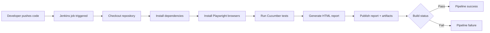
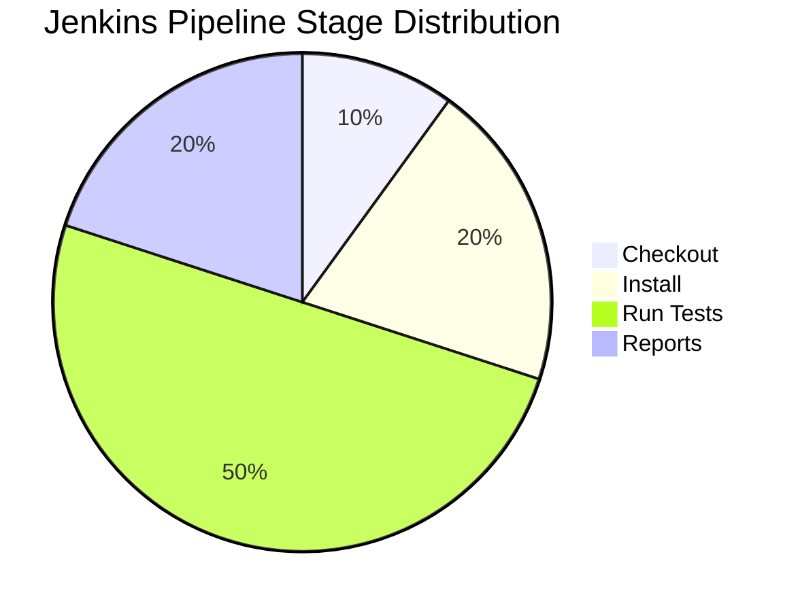

# CLMS Framework - Quick Start Guide

## ⚡ 5-Minute Setup

### 1. Install Dependencies
```bash
npm install
```

### 2. Configure Environment
```bash
cp .env.example .env
# Edit .env with your settings
```

### 3. Run Tests
```bash
# All tests
npm run cucumber:all

# Shift Module
npm run cucumber:shift

# Leave Module
npm run cucumber:leave

# Attendance Module
npm run cucumber:attendance
```

### 4. Flaky Test Handling
This framework is already designed to handle intermittent UI failures:

- Cucumber retries failed scenarios automatically with `retry: 2` in the default profile.
- `features/support/hooks.js` tracks retry counts and logs messages such as `Retrying Scenario (Attempt 2): "Update salary status"`.
- A small stability wait is added on retry to reduce timing issues from delayed DOM updates or popup rendering.
- Screenshots are captured for failed scenarios and stored in `./screenshots/` for quick investigation.
- Global timeouts are set in `cucumber.js`, `playwright.config.js`, and hooks to avoid false failures from slow UI responses.

Example for manual retry override:
```bash
npx cucumber-js --profile default --retry 3
```

Recommended handling approach:
1. Re-run the failed scenario with retry enabled.
2. Check the screenshot under `screenshots/`.
3. Review the Cucumber HTML report for the exact failing step.
4. Prefer explicit waits and stable selectors instead of hard-coded sleeps.

### 5. Parallel Execution Status
This project is currently configured for serial execution, not true parallel execution.

Where it is defined:
```js
// cucumber.js
default: {
  parallel: 1,
  ...
}
```

This means Cucumber runs one scenario worker at a time. The same pattern is repeated across other profiles:
```js
shift: { parallel: 1 }
leave: { parallel: 1 }
attendance: { parallel: 1 }
smoke: { parallel: 1 }
```

If you want serial execution, keep it as:
```js
parallel: 1
```

If you want parallel execution, change it to:
```js
parallel: 2
```

or run directly:
```bash
npx cucumber-js --profile default --parallel 2
```

Important note:
- The current framework creates a single global browser in `features/support/hooks.js`.
- That is valid for serial runs but not ideal for parallel runs.
- For full parallel execution, browser creation and teardown should be handled per worker or per scenario.

### 6. View Reports
```bash
# Cucumber HTML Report
open cucumber-report-extended.html

# Allure Report
npm run allure:report
```

---

## � Jenkins CI/CD Pipeline

This project already includes a Jenkins pipeline definition in [Jenkinsfile](Jenkinsfile). The pipeline is designed to run automatically on a Jenkins agent and execute the Playwright + Cucumber automation suite.

### What the Jenkins pipeline does
1. Checks out the code from Git
2. Installs Node.js dependencies using npm
3. Installs Playwright browser binaries
4. Runs the Cucumber test suite
5. Generates the HTML test report
6. Publishes the report and archives artifacts in Jenkins

### Pipeline workflow





### Required Jenkins setup
- Jenkins installed and running
- Node.js tool configured under Manage Jenkins → Global Tool Configuration
- Git plugin installed
- HTML Publisher plugin installed
- JUnit plugin installed
- A Jenkins job configured to use this repository and the Jenkinsfile
- A Jenkins agent with access to Node/npm and browser dependencies

### Jenkinsfile behavior
The current Jenkinsfile is written to be cross-platform and avoids shell-specific command separators that can fail on Windows-based agents. It uses `checkout scm` for repository retrieval, installs dependencies and browsers, executes the tests, and publishes the final report in Jenkins.

### Example Jenkins job configuration
- Choose: Pipeline
- Definition: Pipeline script from SCM
- SCM: Git
- Repository URL: your GitHub/GitLab repo URL
- Branch: main or your target branch
- Script Path: Jenkinsfile

### Typical execution flow in practice
- A developer pushes code to Git
- Jenkins triggers the pipeline
- The job executes the stages from [Jenkinsfile](Jenkinsfile)
- Test results appear in Jenkins with artifacts and HTML reports
- QA or team members can review the report without opening local files

---

## �📋 Common Commands

| Command | Purpose |
|---------|---------|
| `npm run cucumber:all` | Run all test scenarios |
| `npm run cucumber:shift` | Run shift module tests |
| `npm run cucumber:leave` | Run leave module tests |
| `npm run cucumber:attendance` | Run attendance module tests |
| `npm run cucumber:smoke` | Run smoke tests |
| `npm run cucumber:regression` | Run regression tests |
| `npm run cucumber:report` | Generate reports |
| `npm run allure:report` | Generate Allure report |
| `npm run allure:clean` | Clean Allure results |
| `npm run test:debug` | Dry run tests |
| `npm run clean` | Clean all artifacts |

---

## 🏗️ Architecture Overview

### Tier 1: Gherkin Features
**Business-readable test scenarios**
```gherkin
@SHIFT
Scenario: Create a new shift
    When User creates a new shift
    Then Shift should be created successfully
```

### Tier 2: Step Definitions
**Maps Gherkin to code execution**
```javascript
When('User creates a new shift', async function() {
    // Implementation
});
```

### Tier 3: Page Objects
**UI element locators and interactions**
```javascript
class ShiftPage extends BasePage {
    async createNewShift(data) { }
}
```

### Tier 4: Base Page
**Shared methods across all pages**
```javascript
await page.click(selector);
await page.fill(selector, text);
```

---

## 📦 Project Structure

```text
features/
├── login.feature
├── contractoremployee.feature
├── contractorEmployeeDetails.feature
├── contractorEmployeeFormOperations.feature
├── address.feature
├── bank.feature
├── card.feature
├── deployment.feature
├── document.feature
├── family.feature
├── qualification.feature
├── salary.feature
├── reportingmanager.feature
├── statuschange.feature
├── excelUploadContractor.feature
├── searchcontractor.feature
├── shift.feature
├── weekoff.feature
├── otherdetails.feature
├── pan_validation.feature
├── passport.feature
├── uan.feature
├── etc.
├── step_definitions/
│   ├── *.steps.js
│   └── support/
│       └── hooks.js
pages/
├── base.page.js
├── clmslogin.js
├── salary.js
├── deployment.js
├── document.js
├── family.js
├── qualification.js
├── medical_checkup.js
├── reportingmanager.js
├── shift.js
├── workorder.js
├── mastermodule/
├── otherdetailspage/
├── *.js
utilities/
├── basePage.js
├── browserManager.js
├── testConfig.js
├── testUtils.js
cucumber.js
playwright.config.js
generate-report.js
```

---

## 🎯 Test Tags

The project uses a mix of feature-specific and validation tags rather than only the old generic module names.

### Common tags used in the repo
- `@smoke` / `@Smoke` - smoke coverage
- `@regression` / `@Regression` - regression coverage
- `@Validation` - validation scenarios
- `@shift_module` - shift-related scenarios
- `@salary_` - salary module scenarios
- `@salary_earning_validation` - earning validation scenarios
- `@salary_deduction_validation` - deduction validation scenarios
- `@salary_net_payable_validation` - net payable validation scenarios
- `@salary_duplicate_head_validation` - duplicate head validation
- `@salary_additional_heads_validation` - additional head validation
- `@status_change_validation` - status change validation
- `@count_validation` - count validation scenarios
- `@otherdetails` - other details scenarios
- `@weekoff` - week-off scenarios
- `@pan_validation` - PAN validation scenarios
- `@Birthday`, `@Age_Validation`, `@Calendar` - scenario-specific checks

### Run Tests by Tag
```bash
# Smoke tests
npx cucumber-js --tags "@smoke"

# Regression tests
npx cucumber-js --tags "@regression"

# Salary module tests
npx cucumber-js --tags "@salary_"

# Validation scenarios
npx cucumber-js --tags "@Validation"

# Combined tags (AND)
npx cucumber-js --tags "@status_change_validation and @regression"

# Combined tags (OR)
npx cucumber-js --tags "@smoke or @salary_"
```

---

## 📊 Reporting

### Cucumber HTML Report
- ✅ Auto-generated after each run
- ✅ Located: `cucumber-report-extended.html`
- ✅ Module-specific reports available

### Allure Report
- ✅ Rich interactive reports
- ✅ Screenshots on failure
- ✅ Network HAR files attached
- ✅ Test execution history
- ✅ Trend analysis

**Generate Allure Report:**
```bash
npm run allure:report
```

---

## 🔍 Creating New Tests

### 1. Add Feature File
```gherkin
# features/myfeature.feature
@MYMODULE
Feature: My Feature

Scenario: My Test
    When User does something
    Then Something happens
```

### 2. Add Step Definitions
```javascript
// features/step_definitions/myfeature.steps.js
When('User does something', async function() {
    // Implementation
});
```

### 3. Add Page Object
```javascript
// pages/mymodule/mypage.page.js
class MyPage extends BasePage {
    async doSomething() { }
}
```

### 4. Run Tests
```bash
npx cucumber-js features/myfeature.feature
```

---

## 🛠️ Debugging

### Enable Debug Mode
```bash
npm run test:debug
```

### View Screenshots
```bash
open ./screenshots/
```

### Check Network Logs
```bash
open ./hars/
```

### Browser Console Logs
- Captured in Allure report
- Also in test execution output

---

## 📱 Environment Variables

| Variable | Default | Purpose |
|----------|---------|---------|
| BASE_URL | http://localhost:3000 | Application URL |
| BROWSER | chromium | Browser to use |
| HEADLESS | true | Run headless |
| PARALLEL | 2 | Parallel scenarios |
| TIMEOUT | 30000 | Test timeout (ms) |
| RECORD_VIDEO | false | Record test video |
| RECORD_HAR | true | Record HAR file |

---

## 🎬 Running Tests Locally

### Development
```bash
# Run with headed browser
export HEADLESS=false
npm run cucumber:all
```

### Continuous Integration
```bash
# Run in CI mode
export HEADLESS=true
npm run cucumber:all
npm run cucumber:report
```

### Debug a Specific Test
```bash
npx cucumber-js features/shift.feature --name "Create a new shift successfully"
```

---

## 📚 Learning Resources

- [Cucumber Gherkin Syntax](https://cucumber.io/docs/gherkin/reference/)
- [Playwright API](https://playwright.dev/docs/api/class-page)
- [Page Object Model](https://playwright.dev/docs/pom/)
- [Allure Reports](https://docs.qameta.io/allure-report/)

---

## ✅ Checklist for New Setup

- [ ] Node.js installed (v14+)
- [ ] `npm install` executed
- [ ] `.env` file created from `.env.example`
- [ ] BASE_URL configured
- [ ] `npm run cucumber:shift` runs successfully
- [ ] `cucumber-report-extended.html` generated
- [ ] Allure reports accessible (optional)

---

## 🆘 Troubleshooting

| Issue | Solution |
|-------|----------|
| Tests not found | Check feature file path |
| Page not loading | Verify BASE_URL in .env |
| Timeouts | Increase TIMEOUT value |
| Report not generating | Run `npm run cucumber:report` |
| Allure not working | Install `allure-commandline` globally |

---

## 📞 Support

For issues or questions:
1. Check FRAMEWORK_GUIDE.md for detailed documentation
2. Review test logs in console
3. Check screenshots and HAR files
4. Review step definitions in features/step_definitions/

---

**Happy Testing! 🚀**
